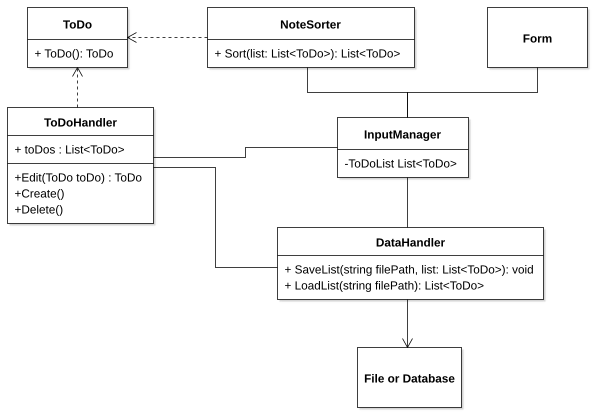
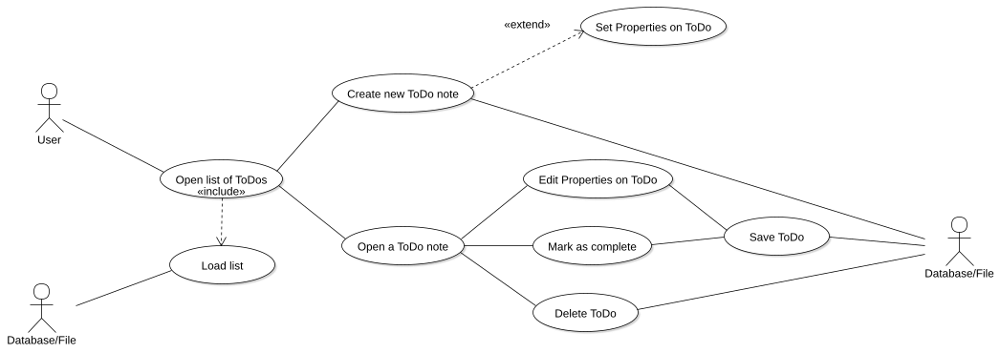
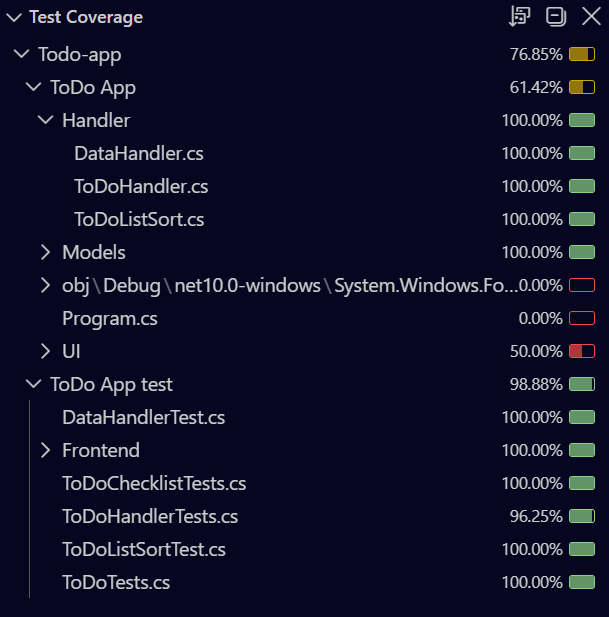

# Todo-app

## Project Description

## Project Techstack
- C#
- .NET
- JSON
- NUnit

## Development Process
- We started by defining the initial requirements for the project and their priorities.
- Each piece of the project was worked on in its own branch to avoid conflicst in the main branch.
- When we were done and the code was ready to be added to the main branch, we first:
    - Created a pull request.
    - Another group member then reviewed the code.
        - If any issues were found with the code or it did not align fully with our requirements, then the code had to be revised before it could be approved.
    - Finally, once it was approved, could it be merged into the main branch.

- To start with our goal was to develop a desktop app using winform that use JSON files to store todoes and user preferences.
- Later on it got added to our requirements that there should be both a desktop and web version both using the same backend.
- We also moved over to using a SQl database to store data instead of using a JSON file.

## UML Diagrams
### Class Diagram

### Use case Diagram

## Project Testing
